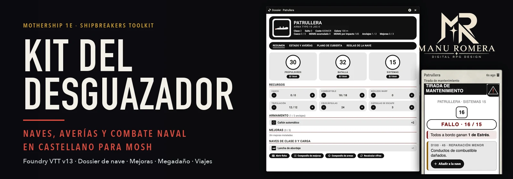
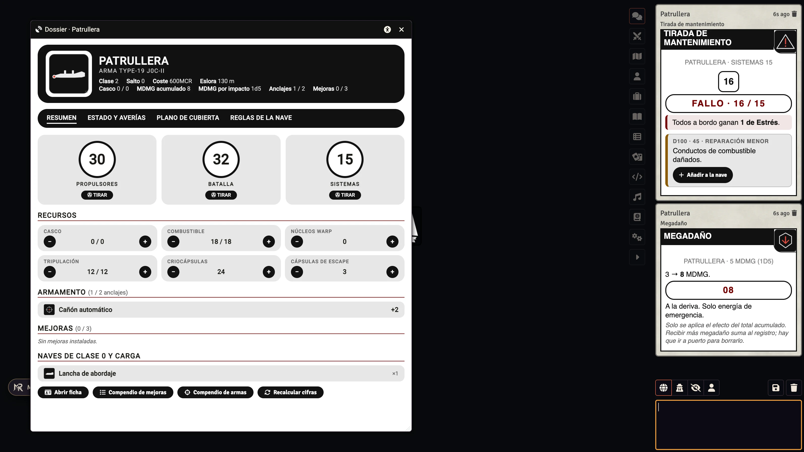
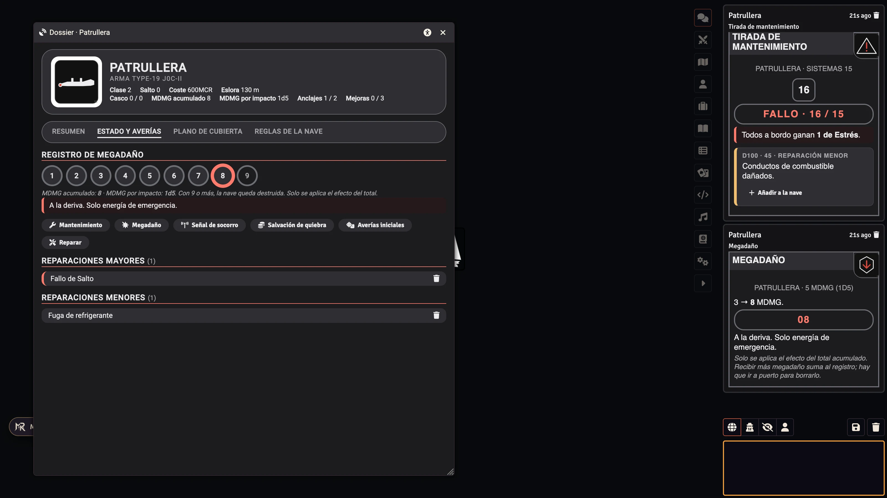
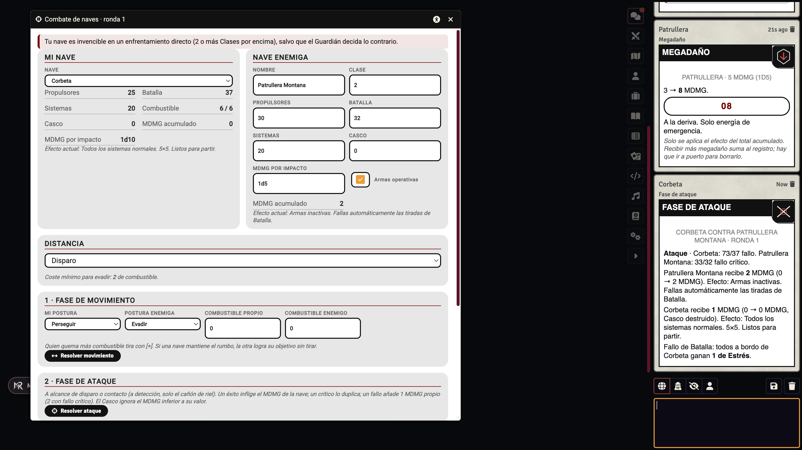
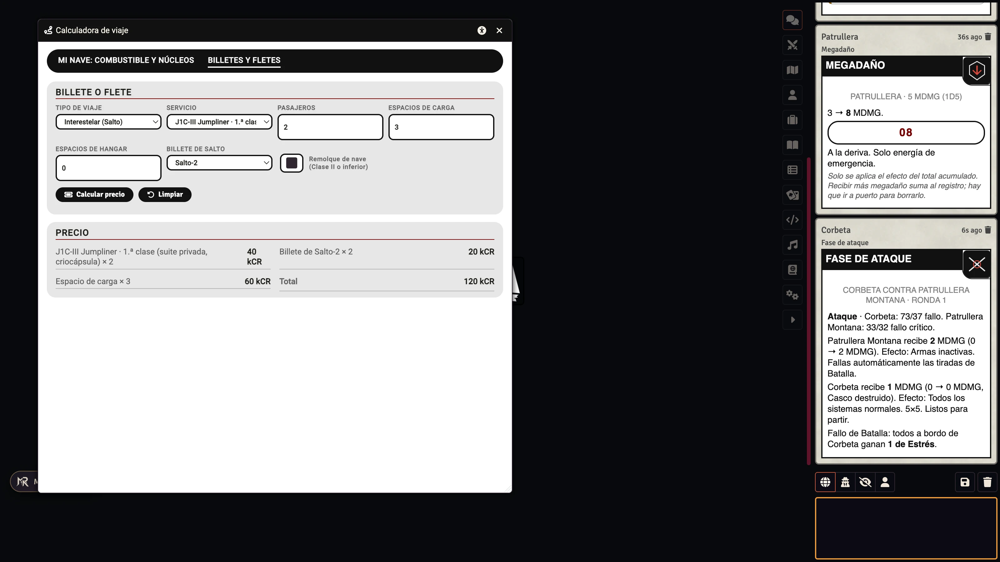

<p align="center"></p>

<p align="center">
  <a href="https://github.com/ManuRomera"></a>
  <a href="https://github.com/ManuRomera/mr-kit-desguazador/releases/latest"></a>
  
  
  
  <a href="https://github.com/ManuRomera/mr-kit-desguazador/releases"></a>
  <a href="LICENSE"></a>
</p>

<h3 align="center">Las naves del Kit del Desguazador, sus averías, su megadaño y su combate,<br>dentro de la ficha de nave de Mothership y con el mismo aspecto que el resto de tus hojas.</h3>

# MR- Kit del Desguazador

Módulo no oficial de **Foundry VTT v13** (v14 sin probar) que lleva a tu mesa todo el contenido del
**Shipbreakers Toolkit** de *Mothership* en español, integrado con el sistema
[`mosh`](https://foundryvtt.com/packages/mosh) (MoSh – Unofficial Mothership, 0.6.1 o superior).

> Este módulo no sustituye la ficha de nave del sistema: la aprovecha. Añade el
> contenido del manual, una pestaña **Dossier** en la ficha de nave y varias
> automatizaciones para mantenimiento, megadaño, combate, viajes y reparaciones.

---

## Así se ve

<p align="center"></p>
<p align="center"> </p>
<p align="center"></p>

## Compatible con el resto de módulos de Mothership

Las ventanas, los diálogos y las tarjetas del chat usan el aspecto de las hojas del sistema `mosh` (blanco y negro, píldoras negras, círculos) y se adaptan solos a lo que ya tengas activado:

| Módulo | Qué comparten |
| --- | --- |
| **MR- Mothership en español** (recomendado) | Una sola configuración de **accesibilidad** (tamaño del texto, contraste, fuente legible, reducir movimiento, ayuda inmediata) y el **modo oscuro**: lo que elijas allí se aplica también al Kit. La pestaña Dossier aparece en la ficha de nave ya traducida. Sin este módulo, el Kit lleva sus propios ajustes de accesibilidad. |
| **MR- Nádir**, **MR- EIDOLON**, **MR- Dirección** | Se pueden usar a la vez: el Kit no toca escenas, música ni relojes, y sus naves valen como naves de esas aventuras. |
| **Sistema mosh** | Usa su ficha de nave (la del Kit del Desguazador), su tirada de mantenimiento, de socorro, de quiebra y de característica; el Kit solo aporta las tablas. |

Las ventanas del Kit recuerdan su posición, su tamaño y la pestaña en la que estabas.

## Contenido

| Compendio | Tipo | Documentos | Qué incluye |
| --- | --- | ---: | --- |
| **Naves (Kit del Desguazador)** | Actor | 10 | Las naves del manual con sus estadísticas, armas, mejoras, naves de Clase 0 a bordo, plano de cubierta y reglas propias. |
| **Mejoras de nave** | Item | 30 | 14 mejoras menores y 16 mayores, con coste, tiempo de instalación y rasgo. |
| **Armas de nave** | Item | 8 | Cañón automático, láser, misiles ligeros y pesados, riel, partículas, contramedidas y defensa láser. |
| **Naves de Clase 0** | Item | 6 | Lancha de abordaje, módulo ataúd, nave de desembarco, cápsula de escape, caza y módulo utilitario. |
| **Vehículos y equipo de nave** | Item | 4 | TBP «Sawtooth», cápsula de desembarco pesada, contenedor de 20 pies y kit de reabastecimiento de armas. |
| **Averías de mantenimiento (d100)** | Item | 100 | Las 100 entradas del manual (69 menores y 31 mayores) como objetos `repair`. |
| **Tablas del Kit del Desguazador** | RollTable | 6 | Averías, megadaño, señales de socorro, quiebra, contrabando de la patrullera y restos valiosos. |
| **Reglas del Kit del Desguazador** | JournalEntry | 16 | Estadísticas, viajes, detección, socorro, combate, megadaño, reparaciones, facturas, armas, mejoras, averías, manifiesto de la nave, costes de viaje, ejemplos de juego y fichas técnicas. |
| **Macros del Kit del Desguazador** | Macro | 11 | Dossier, mantenimiento, megadaño, socorro, quiebra, moral, averías iniciales, viaje, combate, reparaciones y costes. |

### Naves incluidas

Asaltante · Transporte ejecutivo · Carguero · Patrullera · Cúter de salvamento ·
Corbeta · Jumpliner · Transporte de tropas · Nave de exploración · Nave de desembarco.

Cada nave incluye su modelo, Salto y Clase, coste, casco, Propulsores, Batalla,
Sistemas, tripulación, criocápsulas, combustible, cápsulas de escape, anclajes,
mejoras, megadaño, eslora, armas y módulos instalados, descripción y plano de
cubierta. Los valores del sistema siguen la convención de la ficha `mosh`:

- `system.weapon-stats.weapons.max` = bonificación total de las armas instaladas.
- `system.weapon-stats.megadamage.max` = MDMG total (`0`, `1`, `1d5` o `1d10`).
- `system.weapon-stats.hardpoints` = anclajes usados / máximo.
- `system.supplies.upgrades` = mejoras instaladas / máximo.
- `system.megadamage.hits` = registro de 1 a 9 puntos de megadaño.
- `0*` en el MDMG efectivo significa que la nave necesita un arma ofensiva instalada para infligirlo, como dice el manual.
- Las naves de Clase 0 que lleva cada nave (lanchas, cazas, módulos utilitarios…) son objetos de carga con su cantidad; no ocupan mejoras. Los núcleos warp de partida (2 en las naves con Salto) no vienen en el manual: ajústalos a tu mesa.

---

## Instalación

1. Copia la carpeta `mr-kit-desguazador` en `Data/modules/` de tu instalación de Foundry VTT.
2. Activa el módulo en **Configuración → Gestionar módulos**.
3. Activa también el sistema **mosh** (MoSh – Unofficial Mothership) 0.6.1 o superior.
4. Los compendios aparecen en la pestaña **Compendios**. Importa las naves que
   necesites o arrástralas directamente al canvas.

También puedes instalar desde un manifiesto si publicas una *release*:

```text
https://github.com/ManuRomera/mr-kit-desguazador/releases/latest/download/module.json
```

---

## Uso

### Dossier de nave

Con una nave seleccionada o controlada, abre su ficha y pulsa la pestaña **Dossier** (o usa la macro *Abrir dossier de nave*). Se actualiza solo cuando cambia la nave.

- **Resumen:** Características con tirada (usa la tirada de nave del sistema), recursos editables, armamento, mejoras y naves de Clase 0 a bordo.
- **Estado y averías:** registro visual de megadaño con el efecto del total actual, tiradas de mantenimiento, megadaño, socorro, quiebra, averías iniciales y reparación, y las averías instaladas.
- **Plano de cubierta:** el plano numerado de la nave y sus notas.
- **Reglas de la nave:** lo propio de cada nave (inspecciones aduaneras de la Patrullera, ley de salvamento del Cúter, secciones de infantería, viaje típico en Jumpliner, tarifas…).

### Tiradas: las del sistema

El Kit no inventa su propia mecánica de dados: las tiradas son las del sistema `mosh` (por debajo del valor, 90 o más siempre falla, dobles críticos, Ventaja y Desventaja con su regla de críticos, 100 cuenta como 00). Lo que pone el Kit son los **datos**: mientras el ajuste **Usar las tablas del Kit en las tiradas del sistema** esté activo, el sistema usa las tablas del Kit del Desguazador donde antes usaba las suyas.

- **Mantenimiento** (botón de la ficha o macro): tirada de Sistemas del sistema; si fallas, tabla de averías d100 del Kit, Estrés a todos a bordo y enlace del sistema para tirar otra vez tras un fallo crítico. Junto a la avería aparece un botón **Añadir a la nave** que la crea como objeto `repair`.
- **Señal de socorro** y **Salvación de quiebra**: la tirada del sistema con la tabla del Kit.
- **Lista de megadaño de la ficha de nave**: los efectos del Kit.
- **Tiradas de característica** (Propulsores, Batalla, Sistemas): `rollCheck` del sistema.
- **Combate de naves**: las tiradas del panel usan la misma interpretación de resultados que el sistema.

El *Informe tras la batalla* es la misma tirada de mantenimiento, tras un combate en el que la nave ha sufrido MDMG.

### Megadaño y Casco

La macro *Megadaño* suma el MDMG a la nave y deja **una sola marca** en el registro, la del total, con su efecto (solo se aplica el efecto del total acumulado). El Casco ignora el MDMG inferior a su valor; si un impacto lo iguala o lo supera, el Casco queda destruido y la nave sufre el resto. Con 9 o más, la nave queda destruida.

### Combate de naves

La macro *Combate de naves* abre un panel con las tres fases del manual y publica cada una en el chat:

1. **Movimiento:** posturas (evadir, perseguir, mantener el rumbo), combustible gastado (quien gasta más tira con [+]), tirada de Propulsores y cambio de banda de alcance. Si una nave mantiene el rumbo, la otra logra su objetivo sin tirar. Descuenta el combustible y respeta la «fuga de combustible de emergencia» y la «navegación desconectada».
2. **Ataque:** tirada de Batalla de las dos naves, MDMG infligido y recibido (doble con crítico, más 1 o 2 de MDMG propio si fallas), Casco, Ventaja por Clase superior, armas inactivas o ausentes (fallo automático y éxito automático del rival), armas defensivas, contramedidas electrónicas y cañón de riel a alcance de detección.
3. **Moral:** 1d10 contra el MDMG del enemigo para ofrecer un alto el fuego. Desde el panel también puedes lanzar el informe tras la batalla.

El MDMG se aplica automáticamente a la nave propia; el enemigo se lleva en el panel.

### Viajes

La calculadora tiene dos pestañas:

- **Mi nave:** combustible (1 por mes de viaje espacial, más 1 por cambio de rumbo; los inyectores optimizados lo reducen a la mitad), núcleos warp (1 por Salto), coste según la Clase de la nave y un botón para tirar la duración del hiperespacio (2d10 días por Salto). Puede descontar el gasto de la nave. El manual solo da órdenes de magnitud de duración: la fijas tú.
- **Billetes y fletes:** pasajes de lanzadera, J0C-III, Jumpliner y transporte ejecutivo con extras de carga, hangar, destino, billete de Salto y remolque.

### Reparar

La macro *Reparar casco y megadaño* te deja elegir qué se repara (Casco y MDMG, averías mayores, averías menores). Cada reparación mayor cuesta 1d5 MCR × Clase y las resueltas se borran de la nave.

### Sincronización de cifras

Cuando añades o quitas armas, mejoras o naves de Clase 0 a una nave del Kit, el módulo recalcula anclajes, mejoras, Batalla, MDMG y los efectos de las mejoras (Sistemas, Propulsores, combustible, Casco, Clase). Solo toca naves del módulo y trabaja con diferencias, así que respeta lo que edites a mano. El botón *Recalcular cifras* del Dossier lo fuerza.

### Accesibilidad

Todas las ventanas llevan un icono en la cabecera con tamaño del texto, modo oscuro, alto contraste, fuente de alta legibilidad, reducir movimiento y ayuda inmediata. Son ajustes de cliente (cada persona los suyos). Si **MR- Mothership en español** está activo, son los suyos (una sola configuración para todo Mothership); si no, el Kit registra los suyos.

---

## Ajustes

| Ajuste | Ámbito | Por defecto | Descripción |
| --- | --- | --- | --- |
| Botón Dossier en la ficha de nave | Cliente | Activado | Añade la pestaña **Dossier** a la ficha de nave. |
| Usar las tablas del Kit en las tiradas del sistema | Mundo | Activado | Mantenimiento, socorro, quiebra y lista de megadaño usan las tablas del Kit. No modifica los ajustes del sistema. |
| Mantener al día las cifras de la nave | Mundo | Activado | Recalcula las cifras de las naves del Kit al cambiar sus armas, mejoras y naves de Clase 0. |
| Accesibilidad (6 ajustes) | Cliente | — | Tamaño del texto, modo oscuro, alto contraste, fuente legible, reducir movimiento y ayuda inmediata. Solo aparecen si MR- Mothership en español no está activo. |

--- | --- | --- | --- |
| Botón Dossier en la ficha de nave | Cliente | Activado | Añade la pestaña **Dossier** a la ficha de nave. |
| Usar las tablas del Kit en las tiradas del sistema | Mundo | Activado | Mantenimiento, socorro, quiebra y lista de megadaño usan las tablas del Kit. No modifica los ajustes del sistema. |
| Avisar al abrir una nave sin dossier | Cliente | Desactivado | Reservado para avisos de descubrimiento del dossier. |

---

## Estructura del proyecto

```text
mr-kit-desguazador/
├── module.json          Manifiesto del módulo
├── scripts/
│   ├── kit.js           Punto de entrada, ajustes, parche de mantenimiento, pestaña Dossier
│   ├── util.js          Utilidades, tiradas, tablas, megadaño y Casco, chat
│   ├── macros.js        Implementación de las macros
│   ├── dossier.js       Dossier de nave
│   ├── combate.js       Panel de combate naval
│   ├── viaje.js         Calculadora de viaje y billetes
│   ├── sincronizar.js   Cifras de la nave al cambiar armas, mejoras y naves de Clase 0
│   └── accesibilidad.js Accesibilidad compartida y memoria de ventana
├── templates/           Plantillas Handlebars
├── styles/kit.css       Estilos del módulo
├── scripts/zip.mjs      Empaquetado (el mismo en local y en la release)
├── tools/               Generadores de datos, iconos con marca y compendios
├── _data/               JSON intermedios generados
├── packs/               Compendios LevelDB
└── assets/              Iconos SVG de naves y elementos
```

### Recompilar los compendios

```bash
npm install
npm run todo     # contenido + compendios
npm run zip      # genera mr-kit-desguazador.zip sin node_modules
```

`tools/contenido.mjs` contiene los datos del manual (y `tools/textos.mjs` sus textos largos) y genera `_data/*.json`;
`tools/build.mjs` compila esos JSON a compendios LevelDB compatibles con Foundry v13.
Los identificadores son deterministas, de modo que recompilar no rompe enlaces
entre tablas y averías.

---

## Créditos y licencia

- **Mothership** y **Shipbreakers Toolkit**: Tuesday Knight Games.
- **Sistema mosh (MoSh – Unofficial Mothership)**: sus autores.
- **Este módulo**: Manu Romera, publicado bajo licencia MIT.

Consulta [NOTICE.md](NOTICE.md) para los detalles legales. El módulo incluye la traducción al español de las reglas, tablas y ejemplos de juego del manual; no incluye sus ilustraciones, mapas ni maquetación, y no está afiliado ni respaldado por Tuesday Knight Games.
