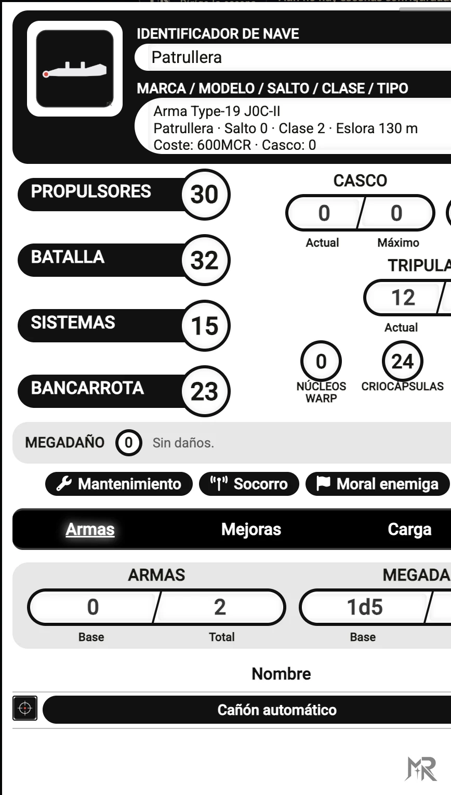
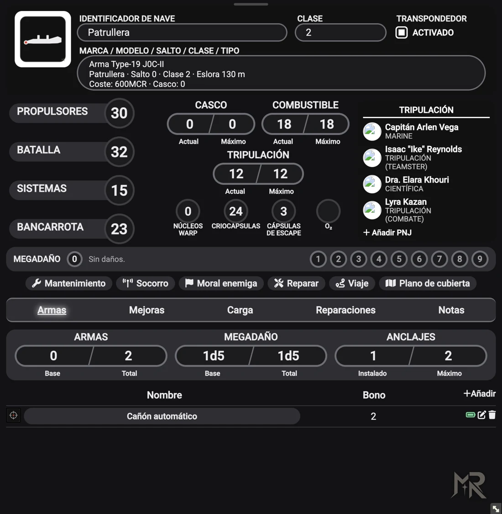
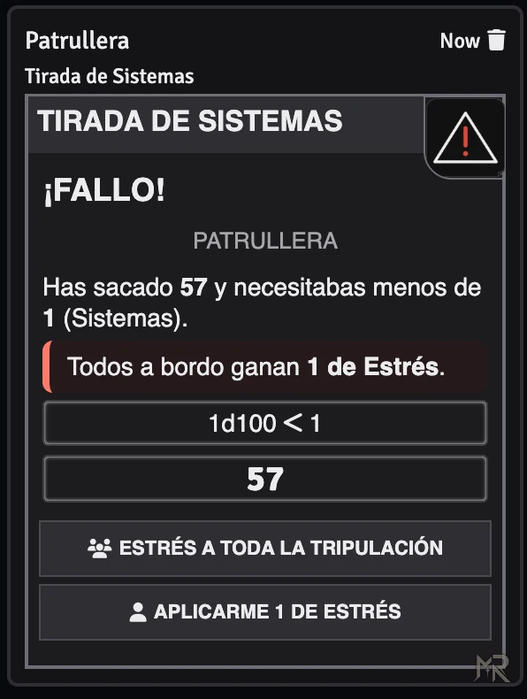
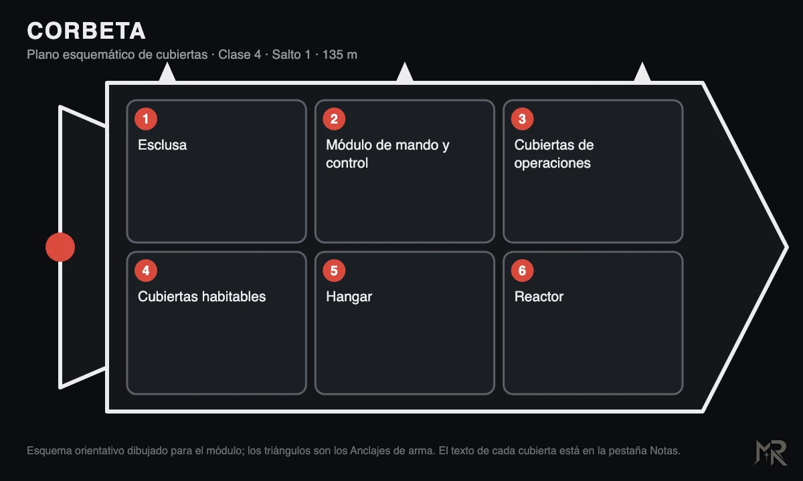

<p align="center"></p>

<p align="center">
  <a href="https://github.com/ManuRomera"></a>
  <a href="https://github.com/ManuRomera/mr-kit-desguazador/releases/latest"></a>
  
  
  
  <a href="https://github.com/ManuRomera/mr-kit-desguazador/releases"></a>
  <a href="LICENSE"></a>
</p>

<h3 align="center">Las naves del Kit del Desguazador, sus averías, su megadaño y su combate,<br>dentro de la ficha de nave de Mothership y con el mismo aspecto que el resto de tus hojas.</h3>

# MR- Kit del Desguazador

Módulo no oficial de **Foundry VTT v13** (v14 sin probar) que lleva a tu mesa todo el contenido del
**Shipbreakers Toolkit** de *Mothership* en español, integrado con el sistema
[`mosh`](https://foundryvtt.com/packages/mosh) (MoSh – Unofficial Mothership, 0.6.1 o superior).

> El módulo trae una **ficha de nave** con el aspecto de la ficha de personaje de Mothership y todo lo del
> manual integrado en ella: tiradas con la tripulación, disparo desde el nombre del arma, reabastecimiento,
> megadaño, mantenimiento, reparaciones y viajes. Sin ventanas aparte.

---

## Así se ve

<p align="center"> </p>
<p align="center"> </p>
<p align="center"></p>

## Compatible con el resto de módulos de Mothership

Las ventanas, los diálogos y las tarjetas del chat usan el aspecto de las hojas del sistema `mosh` (blanco y negro, píldoras negras, círculos) y se adaptan solos a lo que ya tengas activado:

| Módulo | Qué comparten |
| --- | --- |
| **MR- Mothership en español** (recomendado) | Una sola configuración de **accesibilidad** (tamaño del texto, contraste, fuente legible, reducir movimiento, ayuda inmediata) y el **modo oscuro**: lo que elijas allí se aplica también al Kit. Sin este módulo, el Kit lleva sus propios ajustes de accesibilidad. |
| **MR- Nádir**, **MR- EIDOLON**, **MR- Dirección** | Se pueden usar a la vez: el Kit no toca escenas, música ni relojes, y sus naves valen como naves de esas aventuras. |
| **Sistema mosh** | Parte de su ficha de nave (conserva sus objetos, su quiebra y su megadaño), su tirada de mantenimiento, de socorro, de quiebra y de característica; el Kit solo aporta las tablas. |

Las ventanas del Kit (la calculadora de viaje) recuerdan su posición y su tamaño.

## Contenido

| Compendio | Tipo | Documentos | Qué incluye |
| --- | --- | ---: | --- |
| **Naves (Kit del Desguazador)** | Actor | 10 | Las naves del manual con sus estadísticas, armas, mejoras, naves de Clase 0 a bordo, plano de cubierta y reglas propias. |
| **Mejoras de nave** | Item | 30 | 14 mejoras menores y 16 mayores, con coste, tiempo de instalación y rasgo. |
| **Armas de nave** | Item | 8 | Cañón automático, láser, misiles ligeros y pesados, riel, partículas, contramedidas y defensa láser. |
| **Naves de Clase 0** | Item | 6 | Lancha de abordaje, módulo ataúd, nave de desembarco, cápsula de escape, caza y módulo utilitario. |
| **Vehículos y equipo de nave** | Item | 4 | TBP «Sawtooth», cápsula de desembarco pesada, contenedor de 20 pies y kit de reabastecimiento de armas. |
| **Averías de mantenimiento (d100)** | Item | 100 | Las 100 entradas del manual (69 menores y 31 mayores) como objetos `repair`. |
| **Tablas del Kit del Desguazador** | RollTable | 6 | Averías, megadaño, señales de socorro, quiebra, contrabando de la patrullera y restos valiosos. |
| **Reglas del Kit del Desguazador** | JournalEntry | 16 | Estadísticas, viajes, detección, socorro, combate, megadaño, reparaciones, facturas, armas, mejoras, averías, manifiesto de la nave, costes de viaje, ejemplos de juego y fichas técnicas. |
| **Macros del Kit del Desguazador** | Macro | 13 | Abrir la ficha, mantenimiento, megadaño, socorro, quiebra, moral, averías iniciales, viaje, disparar, reabastecer, terminar el combate, reparaciones y costes. |

### Naves incluidas

Asaltante · Transporte ejecutivo · Carguero · Patrullera · Cúter de salvamento ·
Corbeta · Jumpliner · Transporte de tropas · Nave de exploración · Nave de desembarco.

Cada nave incluye su modelo, Salto y Clase, coste, casco, Propulsores, Batalla,
Sistemas, tripulación, criocápsulas, combustible, cápsulas de escape, anclajes,
mejoras, megadaño, eslora, armas y módulos instalados, descripción y plano de
cubierta. Los valores del sistema siguen la convención de la ficha `mosh`:

- `system.weapon-stats.weapons.max` = bonificación total de las armas instaladas.
- `system.weapon-stats.megadamage.max` = MDMG total (`0`, `1`, `1d5` o `1d10`).
- `system.weapon-stats.hardpoints` = anclajes usados / máximo.
- `system.supplies.upgrades` = mejoras instaladas / máximo.
- `system.megadamage.hits` = registro de 1 a 9 puntos de megadaño.
- `0*` en el MDMG efectivo significa que la nave necesita un arma ofensiva instalada para infligirlo, como dice el manual.
- Las naves de Clase 0 que lleva cada nave (lanchas, cazas, módulos utilitarios…) son objetos de carga con su cantidad; no ocupan mejoras. Los núcleos warp de partida (2 en las naves con Salto) no vienen en el manual: ajústalos a tu mesa.

---

## Instalación

1. Copia la carpeta `mr-kit-desguazador` en `Data/modules/` de tu instalación de Foundry VTT.
2. Activa el módulo en **Configuración → Gestionar módulos**.
3. Activa también el sistema **mosh** (MoSh – Unofficial Mothership) 0.6.1 o superior.
4. Los compendios aparecen en la pestaña **Compendios**. Importa las naves que
   necesites o arrástralas directamente al canvas.

También puedes instalar desde un manifiesto si publicas una *release*:

```text
https://github.com/ManuRomera/mr-kit-desguazador/releases/latest/download/module.json
```

---

## Uso

Importa una nave del compendio **Naves** y ábrela: todo está en su ficha.

### La ficha de nave

- **Cabecera y Características:** pulsa **Propulsores, Batalla o Sistemas** para tirar (con la tripulación y el Estrés, ver abajo). Casco, Combustible, tripulación, núcleos warp, criocápsulas, cápsulas de escape y O₂ son editables.
- **Megadaño:** los nueve efectos siempre a la vista; pulsa un círculo para marcarlo o borrarlo. Junto al total se lee el efecto vigente.
- **Acciones:** Mantenimiento, Socorro, Moral enemiga, Reparar, Viaje y Plano de cubierta.
- **Pestañas:** Armas (disparar y reabastecer), Mejoras, Carga, Reparaciones (averías instaladas) y Notas (descripción, plano numerado de cubiertas y reglas propias de cada nave: inspecciones de la Patrullera, ley de salvamento del Cúter, secciones de infantería, tarifas…).
- **Plano de cubierta:** cada nave trae su plano esquemático propio (un dibujo del módulo con sus cubiertas y sus Anclajes), que se abre como imagen y puede mostrarse a los jugadores.
- La ventana no tiene barra de desplazamiento: las listas largas se desplazan dentro de su pestaña.

### Tiradas: las del sistema

El Kit no inventa su propia mecánica de dados: las tiradas son las del sistema `mosh` (por debajo del valor, 90 o más siempre falla, dobles críticos, Ventaja y Desventaja con su regla de críticos, 100 cuenta como 00) y las tarjetas tienen el aspecto de las del sistema y de **MR- Mothership en español** (titular, dados desplegables y botones negros). Lo que pone el Kit son los **datos**: mientras el ajuste **Usar las tablas del Kit en las tiradas del sistema** esté activo, el sistema usa las tablas del Kit del Desguazador donde antes usaba las suyas.

- **Mantenimiento**: tirada de Sistemas del sistema; si fallas, tabla de averías d100 del Kit y enlace del sistema para tirar otra vez tras un fallo crítico. Junto a la avería aparece un botón **Añadir a la nave** que la crea como objeto `repair` y aplica su efecto.
- **Señal de socorro** y **Salvación de quiebra**: la tirada del sistema con la tabla del Kit.
- **Propulsores:** el diálogo permite indicar el **combustible que quemas** (evadir o perseguir: quien gasta más tira con [+]) y lo descuenta.
- **Informe tras la batalla:** es la misma tirada de mantenimiento, tras un combate en el que la nave ha sufrido MDMG.

### Estrés y Pánico de toda la tripulación

Cuando una tirada de la nave falla, todos a bordo ganan 1 de Estrés (y hacen una tirada de Pánico con un fallo crítico). La tarjeta lleva botones para ello:

- **Estrés a toda la tripulación** (y **Pánico a toda la tripulación**, solo para el Guardián): lo aplica a todos los personajes que estén en la tripulación de la nave.
- **Aplicarme 1 de Estrés** (y **Mi tirada de Pánico**): cada jugador se lo aplica a su personaje, si está a bordo.

Cada botón se desactiva una vez usado, así que nadie se aplica el Estrés dos veces.

### Tripulación y habilidades

**Arrastra un personaje a la ficha de la nave** y entra en su tripulación (panel negro de la derecha, con su puesto; el botón *Añadir PNJ* crea un tripulante sin ficha). Al disparar o al tirar Propulsores, Batalla o Sistemas, el diálogo te deja elegir la habilidad de **un** tripulante, y su bonificación se suma a la Característica de la nave: así se llega por encima de la cifra base (Batalla 32 de la Patrullera = 30 de base + 2 de armas; con Mando +15, 47).

### Megadaño y Casco

La macro *Megadaño* (o un disparo) suma el MDMG a la nave y deja **una sola marca** en el registro, la del total, con su efecto (solo se aplica el efecto del total acumulado). El Casco ignora el MDMG inferior a su valor; si un impacto lo iguala o lo supera, el Casco queda destruido y la nave sufre el resto. Con 9 o más, la nave queda destruida.

### Cómo se dispara con una nave

En Mothership las armas de una nave **no se tiran una a una**: cada arma suma su bonificación a la Característica de **Batalla** y fija el MDMG de la nave, y en la fase de ataque la nave hace **una sola tirada de Batalla** contra su objetivo. Por eso se dispara **pulsando el nombre del arma** en la pestaña Armas, como en la ficha de un personaje, y cualquier arma hace esa misma tirada:

1. Marca con **T** el token de la nave objetivo.
2. Pulsa el nombre de cualquier arma ofensiva (o usa la macro *Disparar con la nave*).
3. Elige Normal, Ventaja o Desventaja y, si quieres, la habilidad de un tripulante. La Ventaja por Clase superior se añade sola.
4. **Éxito:** la nave inflige su MDMG al objetivo (doble con crítico), que lo recibe con su Casco. **Fallo:** la nave sufre 1 MDMG (2 con crítico) y la tarjeta ofrece los botones de Estrés.

La tirada de Batalla del objetivo la hace su propia nave cuando dispara. Si no tienes permiso sobre la nave objetivo, la tarjeta lleva un botón para que quien la controla aplique el MDMG. Sin armas o con las armas inactivas (MDMG 2), la nave falla sola. Las contramedidas electrónicas, el sistema de defensa láser, el haz de partículas y el cañón de riel se tienen en cuenta en la tarjeta.

### Reabastecer las armas

Tras un enfrentamiento en el que la nave ha usado sus armas hay que reabastecerlas en puerto. En la pestaña Armas, cada arma muestra una pila: **verde** si está cargada y **roja** si está sin reabastecer; púlsala roja para rearmarla (con su coste por Clase) o usa **Rearmar todas**. Al cerrar el combate del Combat Tracker, las naves que han disparado pasan solas a «sin reabastecer» (si no usas el Combat Tracker, el aviso de la pestaña ofrece **Terminar el combate**). Si no reabasteces, la nave tira Batalla con [-] en el siguiente combate y falla automáticamente después.

### Combate entre naves

No hay un panel aparte: cada nave hace lo suyo desde su ficha, como hace un personaje.

- **Movimiento:** tirada de Propulsores con el combustible quemado (ver arriba).
- **Ataque:** pulsar el nombre del arma.
- **Moral:** botón *Moral enemiga* (1d10 contra el MDMG de la nave enemiga, que pueda estar sin ficha).
- **Después:** *Mantenimiento* para el informe tras la batalla y *Reparar* en puerto.

### Viajes

El botón **Viaje** abre la calculadora, con dos pestañas:

- **Mi nave:** combustible (1 por mes de viaje espacial, más 1 por cambio de rumbo; los inyectores optimizados lo reducen a la mitad), núcleos warp (1 por Salto), coste según la Clase de la nave y un botón para tirar la duración del hiperespacio (2d10 días por Salto). Puede descontar el gasto de la nave. El manual solo da órdenes de magnitud de duración: la fijas tú.
- **Billetes y fletes:** pasajes de lanzadera, J0C-III, Jumpliner y transporte ejecutivo con extras de carga, hangar, destino, billete de Salto y remolque.

### Reparar

El botón *Reparar* (o la macro) te deja elegir qué se repara (Casco y MDMG, averías mayores, averías menores). Cada reparación mayor cuesta 1d5 MCR × Clase y las resueltas se borran de la nave.

### Sincronización de cifras

Cuando añades o quitas armas, mejoras o naves de Clase 0 a una nave del Kit, el módulo recalcula anclajes, mejoras, Batalla, MDMG y los efectos de las mejoras (Sistemas, Propulsores, combustible, Casco, Clase). Solo toca naves del módulo y trabaja con diferencias, así que respeta lo que edites a mano.

### Accesibilidad

La calculadora y los diálogos llevan un icono en la cabecera con tamaño del texto, modo oscuro, alto contraste, fuente de alta legibilidad, reducir movimiento y ayuda inmediata. Son ajustes de cliente (cada persona los suyos). Si **MR- Mothership en español** está activo, son los suyos (una sola configuración para todo Mothership); si no, el Kit registra los suyos.

---

## Ajustes

| Ajuste | Ámbito | Por defecto | Descripción |
| --- | --- | --- | --- |
| Ficha de nave del Kit | Mundo | Activado | Usa la ficha de nave del Kit; al desactivarla vuelve la del sistema (hay que recargar). |
| Usar las tablas del Kit en las tiradas del sistema | Mundo | Activado | Mantenimiento, socorro, quiebra y lista de megadaño usan las tablas del Kit. No modifica los ajustes del sistema. |
| Mantener al día las cifras de la nave | Mundo | Activado | Recalcula las cifras de las naves del Kit al cambiar sus armas, mejoras y naves de Clase 0. |
| Accesibilidad (6 ajustes) | Cliente | — | Tamaño del texto, modo oscuro, alto contraste, fuente legible, reducir movimiento y ayuda inmediata. Solo aparecen si MR- Mothership en español no está activo. |

---

## Estructura del proyecto

```text
mr-kit-desguazador/
├── module.json          Manifiesto del módulo
├── scripts/
│   ├── kit.js           Punto de entrada, ajustes, registro de la ficha, fin de combate
│   ├── util.js          Utilidades, tiradas, tablas, megadaño y Casco, chat
│   ├── macros.js        Implementación de las macros
│   ├── hoja-nave.js     Ficha de nave del Kit (parte de la del sistema)
│   ├── ataque.js        Disparo de la nave
│   ├── viaje.js         Calculadora de viaje y billetes
│   ├── sincronizar.js   Cifras de la nave al cambiar armas, mejoras y naves de Clase 0
│   └── accesibilidad.js Accesibilidad compartida y memoria de ventana
├── templates/           Ficha de nave y calculadora de viaje (Handlebars)
├── styles/kit.css       Estilos del módulo
├── scripts/zip.mjs      Empaquetado (el mismo en local y en la release)
├── tools/               Generadores de datos, iconos con marca y compendios
├── _data/               JSON intermedios generados
├── packs/               Compendios LevelDB
└── assets/              Iconos y siluetas de naves, planos de cubierta (WebP con marca MR)
```

### Recompilar los compendios

```bash
npm install
npm run todo     # contenido + compendios
npm run zip      # genera mr-kit-desguazador.zip sin node_modules
```

`tools/planos.mjs` dibuja el plano esquemático de cada nave a partir de sus cubiertas (luego `tools/marcar.py` lo convierte a WebP con la marca).
`tools/contenido.mjs` contiene los datos del manual (y `tools/textos.mjs` sus textos largos) y genera `_data/*.json`;
`tools/build.mjs` compila esos JSON a compendios LevelDB compatibles con Foundry v13.
Los identificadores son deterministas, de modo que recompilar no rompe enlaces
entre tablas y averías.

---

## Créditos y licencia

- **Mothership** y **Shipbreakers Toolkit**: Tuesday Knight Games.
- **Sistema mosh (MoSh – Unofficial Mothership)**: sus autores.
- **Este módulo**: Manu Romera, publicado bajo licencia MIT.

Consulta [NOTICE.md](NOTICE.md) para los detalles legales. El módulo incluye la traducción al español de las reglas, tablas y ejemplos de juego del manual; no incluye sus ilustraciones, mapas ni maquetación, y no está afiliado ni respaldado por Tuesday Knight Games.
